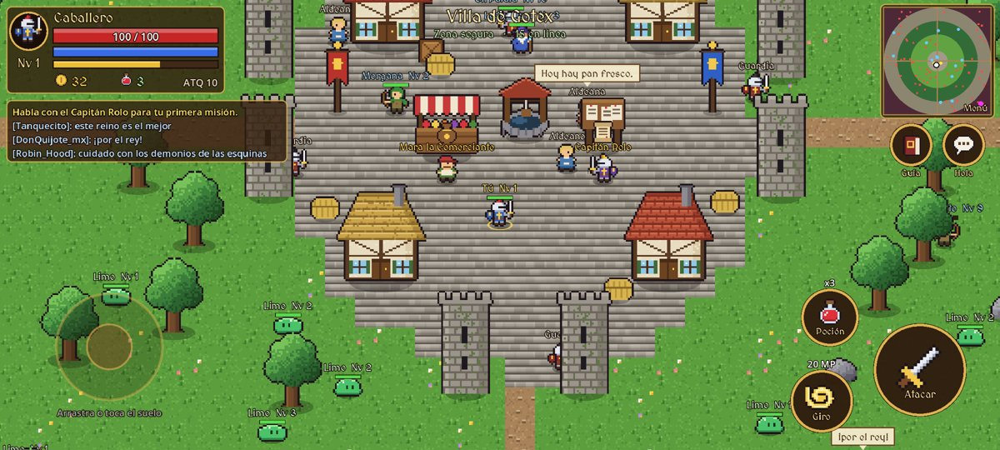
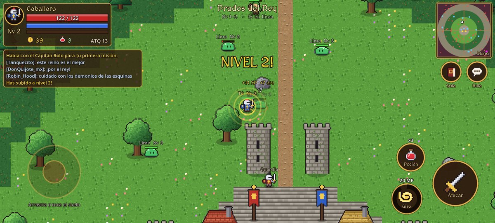
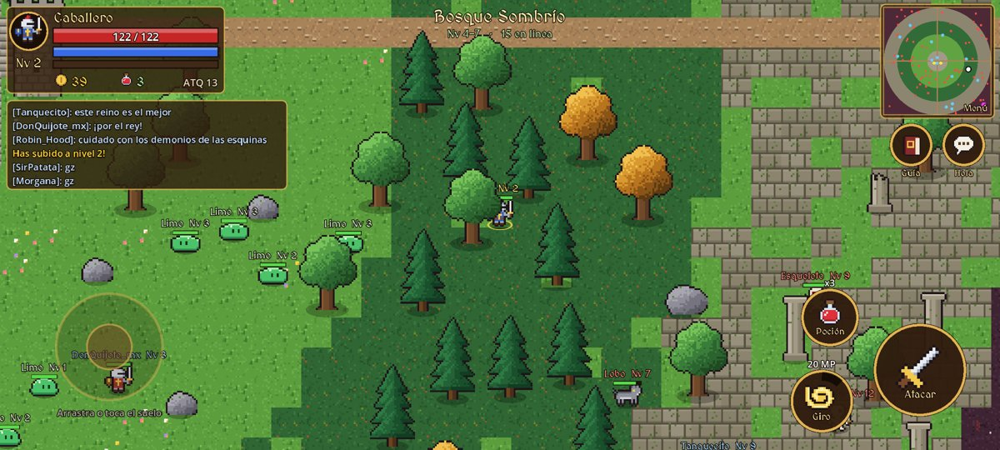
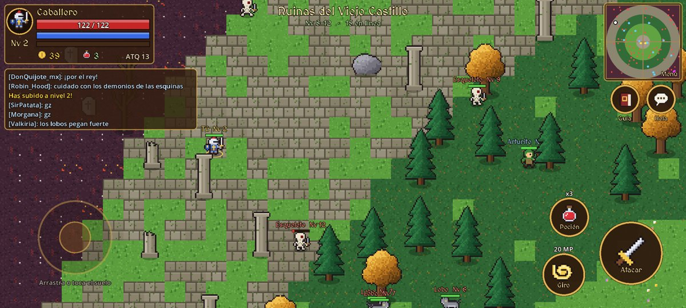
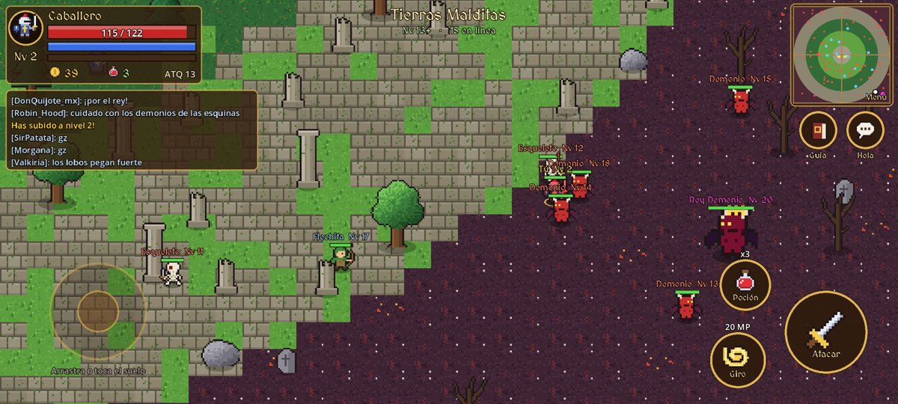
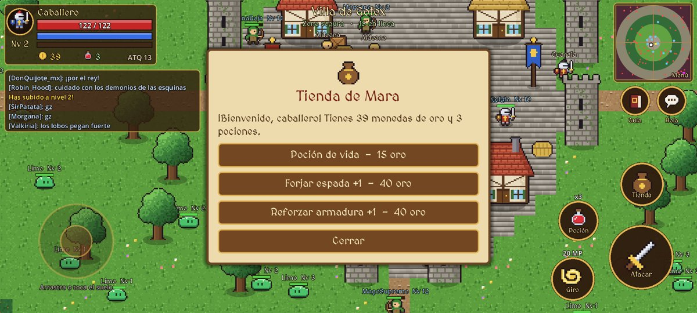
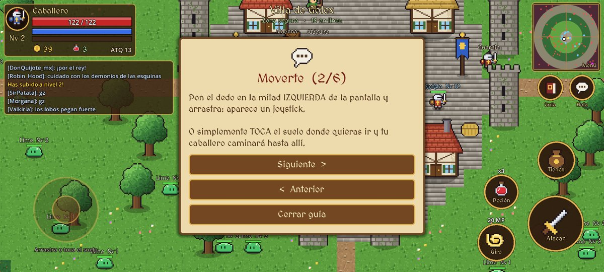

# Gotex Online

Un MMORPG medieval sencillo con vista desde arriba (top-down), hecho en **Godot 4.3**, que se juega **offline en el celular**.
El reino está "poblado" por otros jugadores simulados que cazan monstruos, suben de nivel, vuelven a la villa y escriben en el chat. Así se siente como un MMO sin necesitar internet.



| | |
|---|---|
|  |  |
|  |  |
|  |  |

## Cómo instalarlo en el celular (Android)

1. Entra a la pestaña **Releases** del repositorio (o **Actions → Build Android APK → Artifacts**).
2. Descarga `GotexOnline.apk` desde el celular.
3. Ábrelo y acepta "instalar apps de origen desconocido" si Android lo pide.
4. ¡A jugar! No necesita conexión. La partida se guarda sola.

Cada `push` al repositorio compila un APK nuevo con GitHub Actions (`.github/workflows/android.yml`).

## Cómo se juega

| Control | Acción |
|---|---|
| Arrastrar en la mitad izquierda (joystick) | Moverte |
| Tocar el suelo | Caminar hasta ese punto |
| Tocar un monstruo / un NPC | Atacarlo / ir a hablar con él |
| **Atacar** (espada) | Ataca al monstruo más cercano (mantenlo para seguir peleando) |
| **Giro** | Ataque en área alrededor tuyo (cuesta 20 MP) |
| **Poción** | Cura 50% de la vida |
| **Hola** | Saluda; los jugadores cercanos te responden |
| **Guía** (libro) | Abre la guía del juego (también sale sola la primera vez) |
| **Tienda / Misión** | Aparece al acercarte a un NPC |
| Tocar el minimapa | Menú con tus estadísticas y opción de borrar partida |

En PC: `WASD`/flechas para moverte, `Espacio` atacar, `Q` giro, `E` poción, `F` hablar, `T` saludar, `G` guía, `M`/`Esc` menú.

## El mundo

- **Villa de Gotex** (centro): zona segura con torres, guardias y aldeanos; te curas rápido. Aquí están **Mara la Comerciante** (pociones y mejoras de espada/armadura) y el **Capitán Rolo** junto al tablón (misiones).
- **Prados del Rey** (Nv 1-3): limos.
- **Bosque Sombrío** (Nv 4-7): lobos.
- **Ruinas del Viejo Castillo** (Nv 8-12): esqueletos.
- **Tierras Malditas** (Nv 13+, esquinas del mapa): demonios, y el **Rey Demonio** (Nv 20) en la esquina sureste.

Al morir reapareces en la villa y pierdes el 10% de tu oro.

## Abrirlo en Godot

Abre la carpeta con Godot 4.3 o superior y pulsa *Play*. Para exportar tú mismo a Android necesitas las plantillas de exportación y el SDK de Android configurados en el editor; el preset ya está en `export_presets.cfg`.

El pixel-art es original y se genera con `python3 tools/make_art.py` (personajes, suelo, decoración e iconos en `assets/sprites/`). La fuente es [MedievalSharp](assets/fonts/OFL.txt) (licencia SIL OFL).

## Pruebas automáticas

`godot --path . -- --autotest` simula toques (joystick, tocar el suelo, botón de ataque) y falla si el caballero no se mueve o no ataca. Con `--shots=<carpeta>` además guarda capturas de pantalla. GitHub Actions lo ejecuta en cada cambio, también a resolución de celular (2400x1080), y adjunta las capturas a la release.

## Estructura

```
main.tscn              escena principal
scripts/main.gd        mundo: mapa, aparición de monstruos, eventos, guardado
scripts/game_data.gd   datos: zonas, monstruos, nombres y frases del chat
scripts/entity.gd      base de personajes (vida, daño, dibujo)
scripts/player.gd      jugador
scripts/enemy.gd       monstruos
scripts/bot.gd         jugadores simulados
scripts/npc.gd         comerciante y capitán
scripts/hud.gd         controles táctiles, barras, minimapa, chat y ventanas
scripts/ground.gd, decor.gd, effect.gd, floating_text.gd   gráficos
assets/sprites/        pixel-art generado por tools/make_art.py
assets/fonts/          fuente MedievalSharp (OFL)
```
